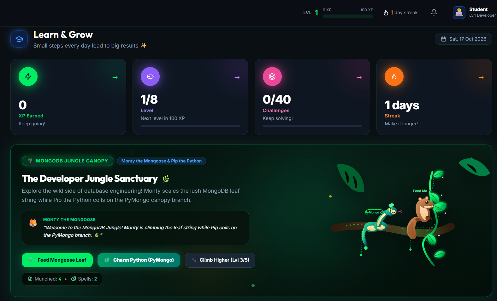
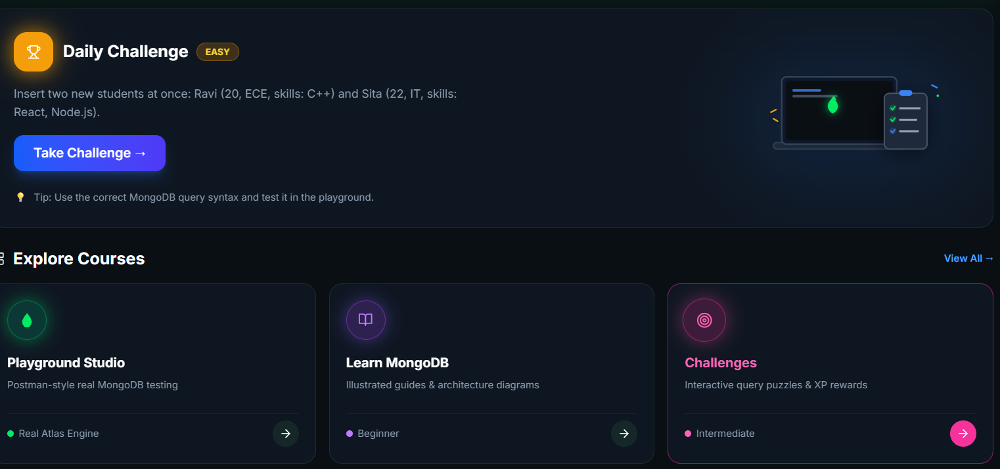
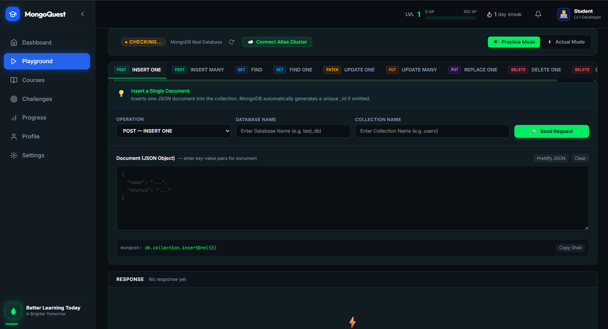
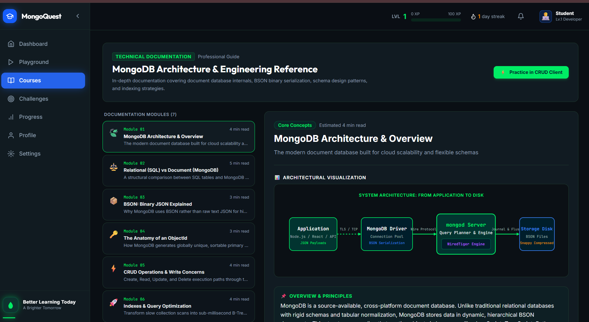
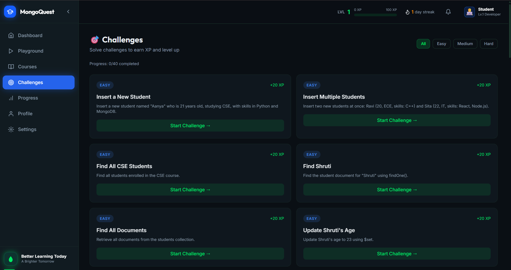
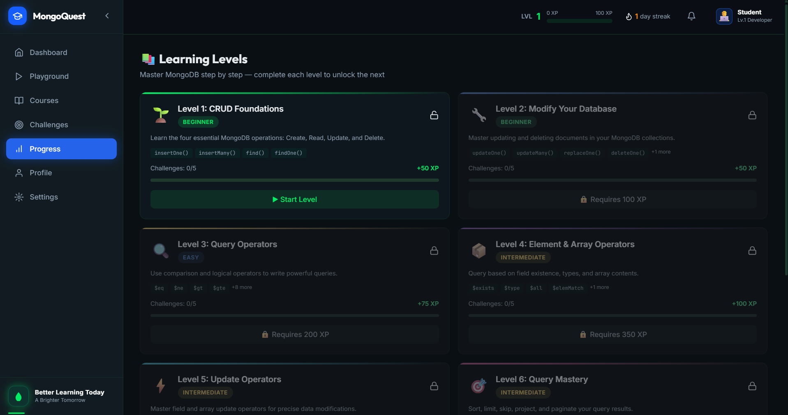
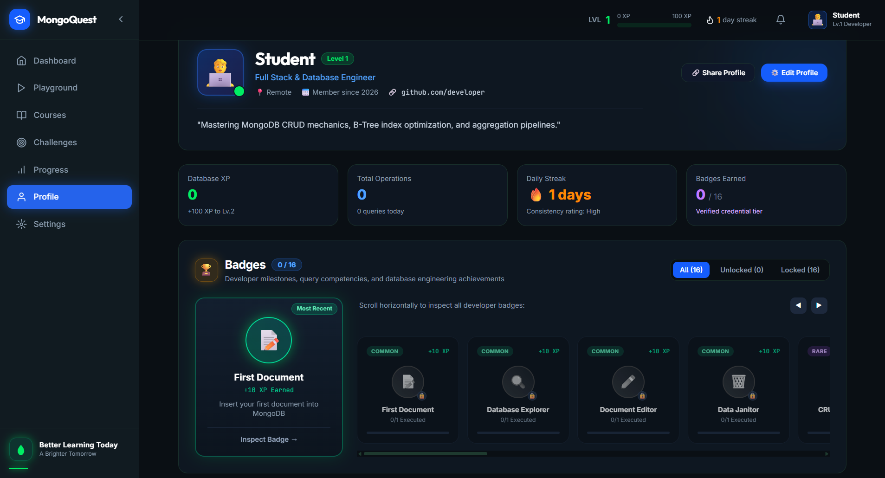
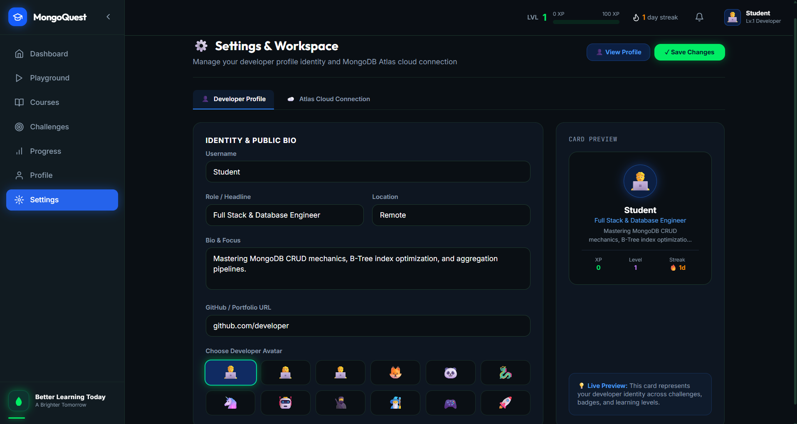

# MongoQuest — Learn MongoDB by Doing

**An interactive, gamified learning platform that makes learning MongoDB practical, visual, and engaging.**

MongoQuest is an educational web application designed to help students learn MongoDB through hands-on practice, interactive CRUD operations, query challenges, and gamified learning experiences. Instead of memorizing database commands, learners can execute operations, observe document changes, understand query results, and build their NoSQL skills step by step.

The platform combines a developer-friendly MongoDB playground with a structured learning path, progress tracking, achievements, and interactive challenges.

---

## Table of Contents

- [Overview](#overview)
- [Key Features](#key-features)
- [Learning Roadmap](#learning-roadmap)
- [Technology Stack](#technology-stack)
- [System Architecture](#system-architecture)
- [Getting Started](#getting-started)
- [Environment Configuration](#environment-configuration)
- [Project Structure](#project-structure)
- [How It Works](#how-it-works)
- [Security Considerations](#security-considerations)
- [Future Enhancements](#future-enhancements)
- [Contributing](#contributing)
- [License](#license)

## Overview

MongoDB is a widely used NoSQL database, but beginners often struggle to understand how database commands work and how they affect stored documents.

MongoQuest addresses this challenge by providing a visual, interactive environment where learners can experiment with MongoDB commands and immediately observe their results.

### Project Objectives

- Simplify MongoDB concepts for beginners.
- Provide hands-on practice for CRUD operations and query operators.
- Demonstrate how database documents change after each operation.
- Encourage consistent learning through challenges and rewards.
- Help students progress from basic queries to advanced database concepts.

## Project Screenshots
### Dashboard



### Playgorund


### Courses


### Challenges


### Progress


### Profile


### Settings



## Key Features

### 1. Interactive MongoDB Playground

Practice database operations through a user-friendly interface.

- Insert single or multiple documents.
- Retrieve all documents or specific matching records.
- Update individual documents or multiple matching records.
- Replace existing documents.
- Delete individual or multiple documents.
- View generated MongoDB commands.
- Inspect operation results and error messages.
- Copy queries for future reference.

### 2. Live Database Explorer

Explore collections and understand document structures through a visual interface.

- View documents in a tabular format.
- Inspect complete documents in JSON format.
- Search and filter records.
- Track document counts.
- Observe changes after successful database operations.
- Work with sample collections in Demo Mode.

### 3. Query Operator Playground

Learn MongoDB query operators through practical examples.

**Comparison operators:** `$eq`, `$ne`, `$gt`, `$gte`, `$lt`, `$lte`, `$in`, `$nin`

**Logical operators:** `$and`, `$or`, `$not`, `$nor`

**Element operators:** `$exists`, `$type`

**Array operators:** `$all`, `$elemMatch`, `$size`

**Update operators:** `$set`, `$unset`, `$inc`, `$mul`, `$push`, `$pull`, `$addToSet`

### 4. Gamified Learning Experience

Make database practice more engaging through:

- Experience points (XP).
- Progressive learning levels.
- Daily learning goals.
- Achievement badges.
- Practice streaks.
- Interactive challenges.
- Progress indicators and completion tracking.
- A leaderboard experience.

### 5. Structured Learning Path

MongoQuest organizes learning into eight progressive levels, from introductory CRUD operations to advanced database concepts.

### 6. Challenge Mode

Solve practical database tasks, construct queries, validate results, and learn from hints and explanations.

Example challenges include finding students above a specified age, updating course details, filtering documents by skills, sorting records, and grouping documents through aggregation.

### 7. Learn MongoDB

Explore concise lessons covering databases, collections, documents, BSON, CRUD operations, query operators, arrays, aggregation pipelines, and indexes.

## Learning Roadmap

| Level | Topic | Difficulty |
|---|---|---|
| 1 | Insert One, Insert Many, Find, Find One | Beginner |
| 2 | Update One, Update Many, Replace One, Delete One, Delete Many | Beginner |
| 3 | Comparison and Logical Operators | Easy |
| 4 | Element and Array Operators | Intermediate |
| 5 | Update Operators | Intermediate |
| 6 | Sorting, Filtering and Projection | Intermediate |
| 7 | Aggregation Pipeline | Advanced |
| 8 | Indexes, Bulk Writes and Transactions | Advanced |

Each level is designed to reinforce concepts through demonstrations and practical exercises.

## Technology Stack

The planned technology stack includes:

| Layer | Technology |
|---|---|
| Frontend | React, TypeScript |
| Styling | Tailwind CSS |
| Backend | Node.js, Express.js |
| Database | MongoDB Atlas |
| Database Integration | Official MongoDB Node.js Driver |
| Development Tools | Git, GitHub, VS Code |

*The stack should be updated to reflect the actual implementation as development progresses.*

## System Architecture

MongoQuest follows a frontend–backend–database architecture.

```text
                 ┌─────────────────────┐
                 │      Student        │
                 └──────────┬──────────┘
                            │
                            ▼
                 ┌─────────────────────┐
                 │   React Frontend    │
                 │                     │
                 │ Playground & Levels │
                 │ Query Editor        │
                 │ Progress Dashboard  │
                 └──────────┬──────────┘
                            │ HTTP / REST API
                            ▼
                 ┌─────────────────────┐
                 │   Node.js + Express │
                 │                     │
                 │ Input Validation    │
                 │ CRUD API Endpoints  │
                 │ Challenge Logic     │
                 └──────────┬──────────┘
                            │
                            ▼
                 ┌─────────────────────┐
                 │    MongoDB Atlas    │
                 │                     │
                 │ Practice Documents  │
                 │ User Progress       │
                 │ Challenge Records   │
                 └─────────────────────┘
```

In Demo Mode, practice operations can run against an in-browser sample dataset without requiring a configured MongoDB connection. Real database persistence requires the backend and MongoDB connection to be configured.

## Getting Started

### Prerequisites

Install the following tools before running the full-stack application:

- Node.js and npm.
- Git.
- A MongoDB Atlas account or a local MongoDB instance, if using the real database backend.

### 1. Clone the Repository

```bash
git clone <your-repository-url>
cd MongoQuest
```

Replace `<your-repository-url>` with the actual Git repository URL.

### 2. Install Dependencies

For a project with separate frontend and backend directories:

```bash
cd frontend
npm install
```

Then install backend dependencies:

```bash
cd ../backend
npm install
```

Adjust these commands to match the actual project structure.

### 3. Configure Environment Variables

Create a `.env` file in the backend directory.

```env
PORT=5000
MONGODB_URI=your_mongodb_connection_string
DB_NAME=mongoquest
```

Replace the placeholder connection string with your MongoDB connection string.

**Important:** Never commit your `.env` file or expose database credentials in frontend code.

### 4. Start the Backend

From the backend directory, run the script defined in `package.json`. For example:

```bash
npm run dev
```

### 5. Start the Frontend

Open another terminal and run:

```bash
cd frontend
npm run dev
```

Open the local URL displayed in the terminal to access MongoQuest.

*These commands assume a conventional React and Express setup. Update them if your generated project uses a different structure or scripts.*

## Environment Configuration

| Variable | Description |
|---|---|
| `PORT` | Backend server port |
| `MONGODB_URI` | MongoDB connection string |
| `DB_NAME` | Name of the application database |

Keep sensitive configuration in environment variables and configure production secrets through your deployment platform.

## Project Structure

A possible full-stack structure is shown below. Adapt it to the actual repository.

```text
MongoQuest/
├── frontend/
│   ├── public/
│   ├── src/
│   │   ├── components/
│   │   ├── pages/
│   │   ├── playground/
│   │   ├── challenges/
│   │   ├── levels/
│   │   ├── hooks/
│   │   ├── services/
│   │   └── App.tsx
│   └── package.json
│
├── backend/
│   ├── src/
│   │   ├── routes/
│   │   ├── controllers/
│   │   ├── services/
│   │   ├── middleware/
│   │   ├── config/
│   │   └── server.js
│   └── package.json
│
├── .gitignore
└── README.md
```

## How It Works

A typical learning session follows this workflow:

1. **Choose an operation:** Select a CRUD command or learning challenge.
2. **Explore the syntax:** Review the generated MongoDB command and its explanation.
3. **Customize the input:** Enter document fields, filters, or update values.
4. **Execute the operation:** Run the command through the playground.
5. **Inspect the result:** Review returned documents, operation counts, and error messages.
6. **Understand the change:** Examine the updated collection or query results.
7. **Earn rewards:** Complete eligible challenges and progress through learning levels.

This workflow connects theoretical knowledge with practical database experience.

## Security Considerations

- Store database credentials in environment variables.
- Validate incoming requests on the backend.
- Restrict database operations to approved collections and commands.
- Use authenticated, user-scoped access when accounts are enabled.
- Prevent users from accessing or modifying other users' practice data.
- Confirm destructive operations where appropriate.
- Avoid exposing arbitrary server-side code execution.
- Use least-privilege database credentials and appropriate network access controls.

## Future Enhancements

Potential improvements include:

- AI-powered query explanations.
- A visual query builder.
- Timed coding challenges.
- Additional aggregation exercises.
- More detailed query execution explanations.
- Personalized learning recommendations.
- Multiplayer challenges and competitive leaderboards.
- A sandbox for experimenting with nested documents and arrays.
- Deployment with persistent user accounts and progress.

## Contributing

Contributions, suggestions, and bug reports are welcome.

1. Fork the repository.
2. Create a feature branch.
3. Implement and test your changes.
4. Submit a pull request with a clear description.


**MongoQuest — Query. Experiment. Level Up.**

*Built to make learning MongoDB more interactive, accessible, and rewarding.*
